# Hi, I'm Fin 👋

Senior Software Engineer. I enjoy building systems, strive to learn new things, and love exploring.

## What I work with


Also: Sidekiq, Redpanda, RSpec, RuboCop, RubyCritic

## Currently

- 🌱 Exploring Go
- 🌐 Putting together a personal portfolio site (Next.js)

## Contributions

<picture>
  <source media="(prefers-color-scheme: dark)" srcset="https://raw.githubusercontent.com/RofinAndreven/RofinAndreven/output/pacman-contribution-graph-dark.svg">
  <source media="(prefers-color-scheme: light)" srcset="https://raw.githubusercontent.com/RofinAndreven/RofinAndreven/output/pacman-contribution-graph.svg">
  
</picture>

## Coding Activity

<!--START_SECTION:waka-->


📊 **This Week I Spent My Time On** 

```text
💬 Programming Languages: 
Ruby                     5 hrs 6 mins        █████████░░░░░░░░░░░░░░░░   37.91 % 
C#                       4 hrs 17 mins       ████████░░░░░░░░░░░░░░░░░   31.82 % 
YAML                     1 hr 8 mins         ██░░░░░░░░░░░░░░░░░░░░░░░   08.52 % 
JSON                     1 hr 4 mins         ██░░░░░░░░░░░░░░░░░░░░░░░   07.98 % 
Markdown                 53 mins             ██░░░░░░░░░░░░░░░░░░░░░░░   06.56 % 

🔥 Editors: 
VS Code                  10 hrs 37 mins      ████████████████████░░░░░   78.81 % 
Claude Code              2 hrs 50 mins       █████░░░░░░░░░░░░░░░░░░░░   21.15 % 
Copilot CLI              0 secs              ░░░░░░░░░░░░░░░░░░░░░░░░░   00.04 % 
```


 Last Updated on 25/11/2026 01:11:53 UTC
<!--END_SECTION:waka-->

## Connect

- Portfolio: 
- LinkedIn: https://www.linkedin.com/in/rofin-andreven
- Email: rofinandreven@gmail.com
